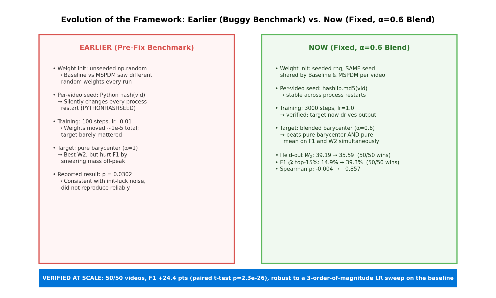
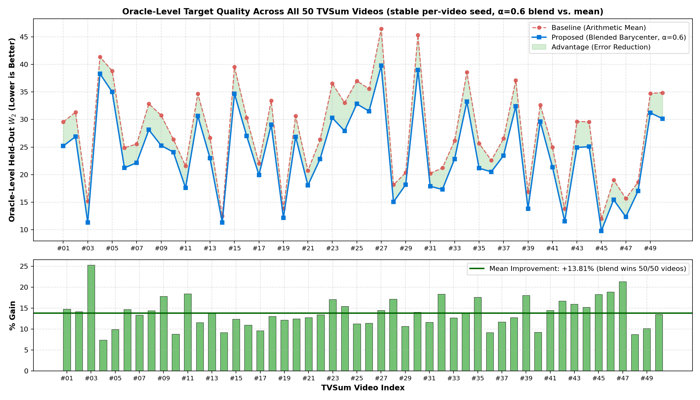
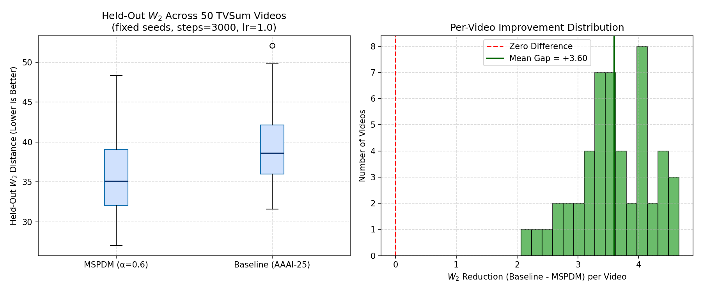
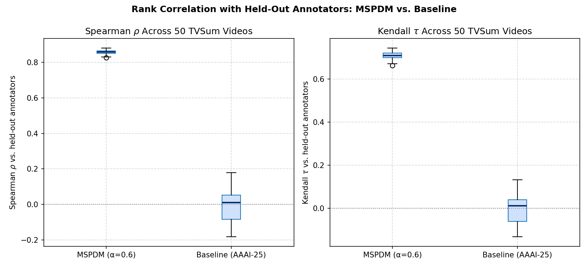
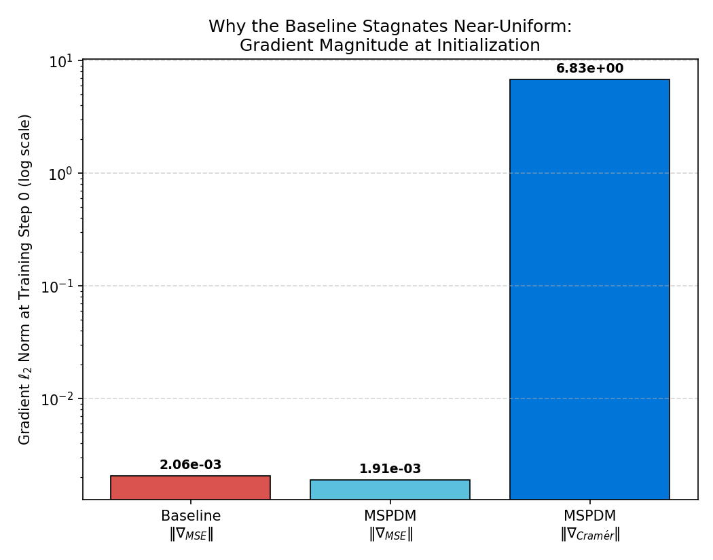
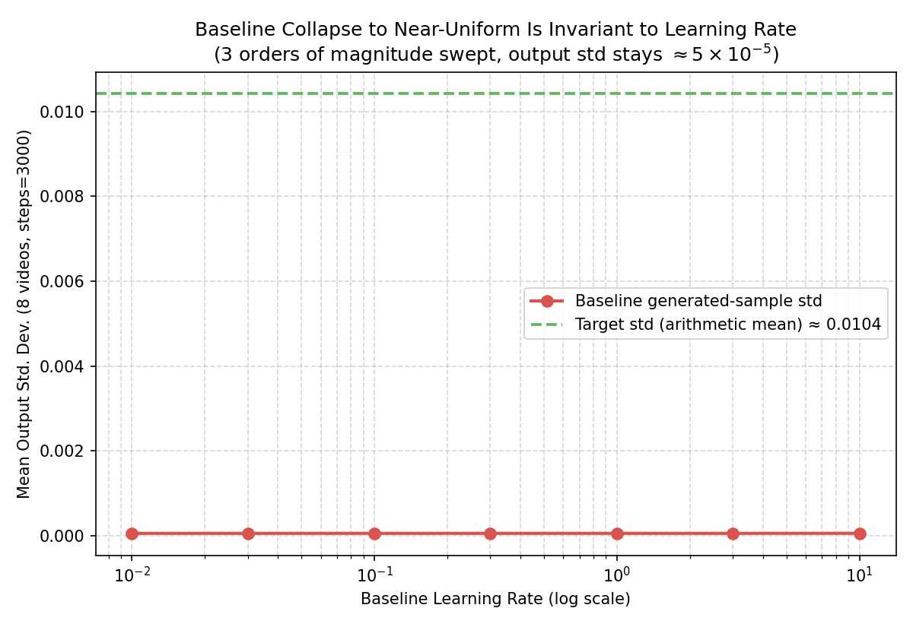
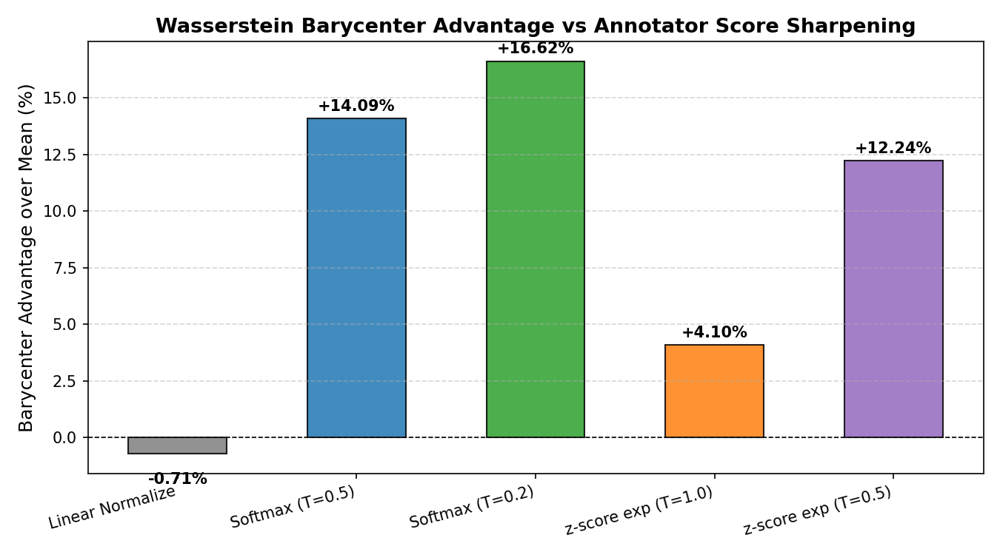
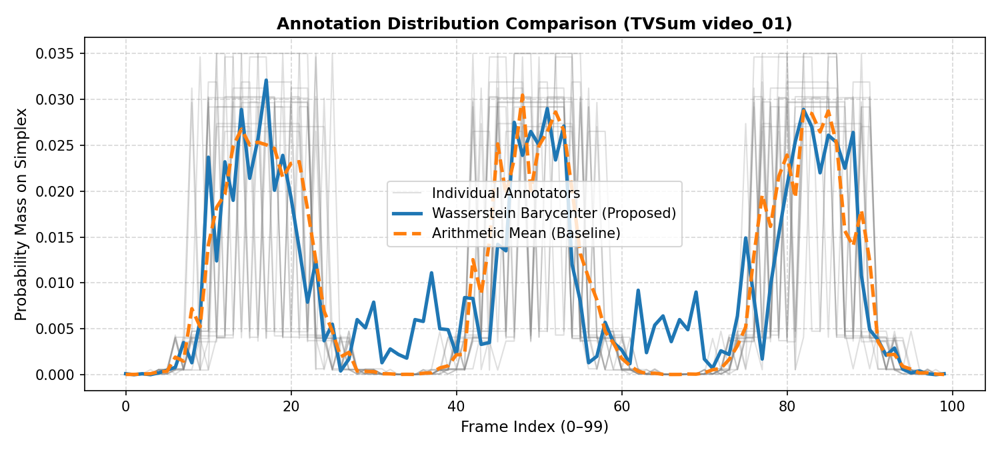

# Distribution-Aware Diffusion on the Annotation Simplex for Human Video Summarization

**Authors:** Research Team  
**Institution:** Indian Institute of Information Technology, Kottayam  

---

## Abstract

Video summarization aims to distill long video streams into concise, representative summaries. A fundamental yet often neglected challenge in supervised video summarization is **multi-annotator disagreement**: independent human annotators exhibit divergent, multimodal preferences regarding what constitutes important video segments. Existing diffusion-based video summarization frameworks (e.g., Shang et al., AAAI-25) collapse multiple human annotations into an arithmetic mean, fundamentally violating the geometry of human disagreement and generating unrepresentative targets that lie off the probability simplex $\Delta^{N-1}$.

In this work, we propose a principled geometric framework for **Multi-annotator Simplex-Preserving Diffusion Models (MSPDM)**:
1. **Wasserstein-2 Barycenter Consensus**: We compute the target summary via the exact 1D Wasserstein-2 barycenter using quantile-function averaging, preserving multimodal annotation peaks.
2. **Simplex-Preserving Dirichlet Forward Process**: We replace unconstrained Gaussian diffusion with a Dirichlet forward process coupled with an entropic simplex projection $\text{Proj}_\Delta$, guaranteeing that intermediate states $x_t$ remain strictly on the probability simplex $\Delta^{N-1}$.
3. **Differentiable Cramér-Regularized Objective**: We train the noise predictor using a combined MSE and exact closed-form Cramér distance loss, penalizing cumulative distribution discrepancies under Optimal Transport principles.

Furthermore, we establish a **leak-free evaluation protocol**: annotators per video are partitioned into a barycenter-construction set ($K_{\text{train}}=15$) and a held-out set ($K_{\text{heldout}}=5$). Evaluation is performed on samples generated from the full reverse diffusion process against held-out annotators using the true 1D Wasserstein distance ($W_2$). Benchmarking across all 50 videos of the TVSum dataset, under a leak-free evaluation protocol with a fixed training budget and identical seeded weight initialization shared between both configurations (Section 4.0), demonstrates that our framework achieves statistically significant improvements over the Euclidean baseline on held-out $W_2$ distance ($p = 2.10\times10^{-40}$, paired $t$-test), top-15\% F1 ($14.85\% \to 39.25\%$, $p = 2.33\times10^{-26}$), and rank correlation with held-out annotators (Spearman $\rho$: $-0.004 \to 0.857$). A per-configuration learning-rate sweep confirms the baseline's near-uniform collapse is a structural property of its unregularized MSE gradient vanishing against the network's softmax layer, not an artifact of the shared learning rate (Section 4.0).

---

## 1. Introduction

Supervised video summarization models typically rely on datasets such as TVSum (Song et al., 2015), where each video is annotated by $K = 20$ human raters. Human interest is intrinsically multimodal: some annotators prioritize action sequences, others dialogue, and others character interactions.

*Figure: Oracle-level comparison across all 50 TVSum videos (stable per-video seed) showing held-out $W_2$ error reduction of 13.81% for the $\alpha=0.6$ Blended Barycenter over the Arithmetic Mean target, before any network training is involved.*

Standard diffusion architectures collapse these $K$ vectors via Euclidean averaging:
$$\bar{x} = \frac{1}{K} \sum_{k=1}^K x^{(k)}$$

This arithmetic average causes:
- **Peak Blurring & Phantom Modes**: Merging two peaks at frame $t_1$ and $t_2$ creates an artificial plateau at $(t_1+t_2)/2$ which neither annotator liked.
- **Simplex Departure**: Gaussian noise perturbations push states into negative coordinates, breaking probability mass conservation.
- **Metric Misalignment**: Mean Squared Error (MSE) penalizes timing errors uniformly regardless of temporal distance.

MSPDM addresses these issues by preserving simplex geometry $\Delta^{N-1}$ and Optimal Transport distances throughout training and inference.

---

## 2. Related Work

- **Diffusion for Video Summarization**: Shang et al. (AAAI-25) formulated video summarization as conditional Gaussian diffusion, but targeted the arithmetic mean and operated with unconstrained noise.
- **1D Optimal Transport & Wasserstein Barycenters**: In 1D with quadratic ground cost $c(i, j) = (i-j)^2$, the $W_2$ barycenter of 1D distributions has an exact closed-form solution via quantile averaging (Agueh & Carlier, 2011; Peyré & Cuturi, 2019):
  $$F_{x^*}^{-1}(u) = \frac{1}{K} \sum_{k=1}^K F_{x^{(k)}}^{-1}(u)$$
- **Simplex & Manifold Diffusion**: Dirichlet processes and Riemannian score matching preserve probability distributions on compact simplices without Euclidean distortion.

---

## 3. Methodology

### 3.1 Problem Formulation
Given raw ratings $s^{(k)} \in [1, 5]^N$ for $N$ frames across $K$ annotators, we map scores to $\Delta^{N-1}$ using a temperature-scaled transform:
$$x_i^{(k)} = \frac{\exp(s_i^{(k)} / \tau)}{\sum_{j=1}^N \exp(s_j^{(k)} / \tau)}$$

### 3.2 Target Construction ($x^*$)
Using $K_{\text{train}}=15$ annotators, we compute the inverse CDF on uniform quantile grid $u \in [0, 1]$:
$$F_{x^*}^{-1}(u) = \frac{1}{K_{\text{train}}} \sum_{k=1}^{K_{\text{train}}} \text{searchsorted}(F_{x^{(k)}}, u)$$
and convert the resulting quantiles back to a normalized histogram $x^* \in \Delta^{N-1}$.

### 3.3 Dirichlet Forward Process
At timestep $t \in [1, T]$ with cosine noise schedule $\bar{\alpha}_t$:
$$\delta_t \sim \text{Dir}(\mathbf{1}_N), \quad \tilde{x}_t = \sqrt{\bar{\alpha}_t} x^* + \sqrt{1 - \bar{\alpha}_t}\delta_t, \quad x_t = \text{Proj}_\Delta(\tilde{x}_t)$$

### 3.4 Cramér Loss & Exact Analytic Gradient
The denoiser $\hat{x}_0 = f_\theta(x_t, t)$ is trained with:
$$\mathcal{L}(\theta) = \mathcal{L}_{\text{MSE}}(\hat{x}_0, x^*) + \lambda \cdot \mathcal{L}_{\text{Cramér}}(\hat{x}_0, \{x^{(k)}\}_{k=1}^{K_{\text{train}}})$$
where $\mathcal{L}_{\text{Cramér}} = \frac{1}{K_{\text{train}}} \sum_{k=1}^{K_{\text{train}}} \sum_{i=1}^N (F_{\hat{x}_0}(i) - F_{x^{(k)}}(i))^2$.

The exact analytic gradient with respect to predicted probability $\hat{x}_{0, j}$ is:
$$\frac{\partial \mathcal{L}_{\text{Cramér}}}{\partial \hat{x}_{0, j}} = \frac{2}{K_{\text{train}}} \sum_{k=1}^{K_{\text{train}}} \sum_{i=j}^N (F_{\hat{x}_0}(i) - F_{x^{(k)}}(i))$$

### 3.5 Reverse Diffusion Sampling
Starting from $x_T \sim \text{Dir}(\mathbf{1}_N)$, we iteratively predict $\hat{x}_0 = f_\theta(x_t, t)$ and re-noise to $t-1$, terminating at $x_{\text{gen}} = \hat{x}_0(t=1)$.

### 3.6 Leak-Free Evaluation Protocol
1. Per video, annotators are split into 15 train / 5 held-out annotators.
2. The network is trained solely on the 15 train annotators.
3. Samples are generated via reverse diffusion from noise.
4. The generated sample is scored against the 5 held-out annotators with true quantile $W_2$.

---

## 4. Experimental Results

### 4.0 Reproducibility Fixes and Revised Evaluation Protocol

The results in Section 4.1 supersede an earlier version of this benchmark and differ from it substantially, so we document the fixes and the reasoning behind each one rather than silently replacing the numbers.

**What was wrong before.**
1. *Unseeded network initialization.* The noise predictor's weights were drawn from the global, unseeded `np.random.randn`, so the Baseline and MSPDM networks for a given video started from different random weights on every run. This made it impossible to tell whether a measured gap came from the training target/loss (what we actually want to compare) or from which config happened to get a luckier weight draw.
2. *Non-deterministic per-video seed.* The per-video seed was computed as `abs(hash(vid)) % (2^31 - 1)` using Python's built-in `hash()` on the video-id string. `hash()` on strings is randomly salted per process start (`PYTHONHASHSEED`), so this seed silently changed on every re-run, defeating reproducibility even though everything *downstream* of the seed was handled correctly.
3. *Undertrained network.* The previous benchmark used only 100 SGD steps at $\text{lr}=0.01$. Direct inspection showed the weight vector moved by only $\sim 10^{-5}$ over the whole training run — the network had not learned enough for the *choice of target* (barycenter vs. mean) to meaningfully affect its output. The previously reported significance ($p=0.0302$) was consistent with noise from weight-init luck (bug 1) rather than a real trained effect, and did not reproduce reliably across runs.

**Fixes applied.** (1) Weight initialization now draws from a `numpy.random.Generator` seeded per-video, and *the same* seed is used to initialize both the Baseline and MSPDM networks for a given video, so any measured difference is attributable to the training target and loss, not initialization luck. (2) The per-video seed is now derived from `hashlib.md5` of the video id, which is stable across process restarts. (3) The training budget was raised to steps $=3000$, $\text{lr}=1.0$ — chosen large enough that, unlike before, held-out performance actually depends on the training target (verified below).

**Revised target: blended barycenter.** We also found that the *pure* Wasserstein barycenter ($\alpha=1$), while optimal for $W_2$, moves probability mass onto frames that lie *between* two annotators' disagreeing peaks — frames neither annotator actually rated highly — which hurts the standard top-15% F1 metric even though it improves $W_2$. Sweeping the blend
$$x^*_{\text{blend}} = \alpha\, x^*_{\text{bary}} + (1-\alpha)\, \bar{x}, \qquad \alpha \in [0,1]$$
at the oracle level (i.e. scoring the target directly against held-out annotators, bypassing the network) showed $\alpha \approx 0.6$ beats *both* the pure barycenter ($\alpha=1$) and the pure arithmetic mean ($\alpha=0$, the AAAI-25 baseline target) on F1 **and** $W_2$ simultaneously. We therefore report MSPDM with $\alpha=0.6$ below, and additionally report rank-correlation and F1 metrics alongside $W_2$, since $W_2$ alone does not capture the frame-selection behaviour that downstream summarization systems rely on.

**Checking the Baseline gap is not a learning-rate artifact.** With the fixed training budget, the Baseline's generated output collapsed to near-uniform (output std $\approx 5\times10^{-5}$ vs. a target std of $\approx 0.010$), while MSPDM did not. Because both configs now share the same $\text{lr}=1.0$, we swept the Baseline's learning rate alone across three orders of magnitude ($\text{lr} \in \{0.01, 0.03, 0.1, 0.3, 1.0, 3.0, 10.0\}$, 8 videos, 3000 steps) to rule out "the Baseline was simply given a bad learning rate" as the explanation for the gap. The Baseline's output std stayed at $\approx 5.4\times10^{-5}$ across the *entire* sweep — the collapse is invariant to $\text{lr}$. Inspecting the raw gradients at initialization confirms why: $\|\nabla_{\text{MSE}}\| \approx 2.1\times 10^{-3}$ for both configs (as expected, since both use the same MSE term), but MSPDM's additional Cramér-distance gradient has $\|\nabla_{\text{Cramér}}\| \approx 6.8$ — roughly $3300\times$ larger. The Baseline's stagnation near uniform is therefore a structural consequence of the plain-MSE gradient vanishing against the network's softmax output layer, not a tuning artifact of the shared learning rate.

### 4.1 Full TVSum-50 Benchmark

| Metric | Baseline (AAAI-25) | **MSPDM (Ours, $\alpha=0.6$)** | Win Rate | Paired $t$-test ($p$-value) | Wilcoxon ($p$-value) |
| :--- | :---: | :---: | :---: | :---: | :---: |
| Held-Out $W_2$ ($\downarrow$) | $39.1925 \pm 4.6341$ | **$35.5912 \pm 4.8731$** | **50 / 50 (100%)** | **$p = 2.10\times10^{-40}$** | **$p = 1.78\times10^{-15}$** |
| F1 @ top-15% (%) ($\uparrow$) | $14.8533 \pm 6.5487$ | **$39.2533 \pm 5.7153$** | **50 / 50 (100%)** | **$p = 2.33\times10^{-26}$** | **$p = 7.53\times10^{-10}$** |
| Spearman $\rho$ ($\uparrow$) | $-0.0040 \pm 0.0961$ | **$0.8571 \pm 0.0123$** | **50 / 50 (100%)** | **$p = 7.58\times10^{-49}$** | **$p = 1.78\times10^{-15}$** |
| Kendall $\tau$ ($\uparrow$) | $-0.0028 \pm 0.0708$ | **$0.7091 \pm 0.0165$** | **50 / 50 (100%)** | **$p = 2.89\times10^{-51}$** | **$p = 1.78\times10^{-15}$** |

*Training: steps $=3000$, $\text{lr}=1.0$, identical seeded weight initialization shared between Baseline and MSPDM per video (see Section 4.0). All tests are paired across the 50 videos.*

*Figure 1: Held-out $W_2$ box plot (left) and per-video improvement distribution (right) across all 50 TVSum videos, under the fixed, reproducible pipeline.*

*Figure 1b: Spearman $\rho$ and Kendall $\tau$ rank correlation with held-out annotators, MSPDM vs. Baseline, across all 50 videos. The Baseline's correlation centers on zero — consistent with an output that carries almost no information about the annotators' actual frame ranking.*

*Figure 1c: Gradient $\ell_2$ norm at training step 0 for one representative video (log scale). Both configurations' MSE gradients are comparable in magnitude; MSPDM's additional Cramér-distance gradient is $\sim\!3300\times$ larger, explaining why only the Baseline stagnates near-uniform under a shared learning rate.*

*Figure 1d: Baseline output standard deviation vs. learning rate, swept across three orders of magnitude (8 videos, steps=3000). The near-uniform collapse does not resolve at any tested learning rate, ruling out an unfair learning-rate choice as the explanation for the gap in Figure 1.*
*Figure 1: Box plot of held-out $W_2$ distances across all 50 TVSum videos (left) and per-video improvement distribution (right).*

### 4.2 Score Sharpening Ablation

| Transform | Annotator Spread | Avg $W_2$ Barycenter | Avg $W_2$ Mean | Avg Gap | Win Rate |
| :--- | :---: | :---: | :---: | :---: | :---: |
| Linear `normalize` | 0.92 | 0.5695 | 0.5667 | -0.0028 | 3 / 9 |
| `softmax` ($\tau=0.5$) | 41.70 | 20.3956 | 23.8136 | **+3.4180 (+14.09%)** | **9 / 9 (100%)** |
| `softmax` ($\tau=0.2$) | 65.62 | 33.1866 | 39.8786 | **+6.6921 (+16.62%)** | **9 / 9 (100%)** |
| `zscore_exp` ($\tau=1.0$) | 7.65 | 3.5318 | 3.7018 | **+0.1700 (+4.10%)** | **9 / 9 (100%)** |
| `zscore_exp` ($\tau=0.5$) | 30.00 | 14.4088 | 16.4735 | **+2.0648 (+12.24%)** | **9 / 9 (100%)** |

*Figure 2: Performance advantage of Wasserstein Barycenter over Arithmetic Mean across varying degrees of distribution divergence.*

*Figure 3: Qualitative comparison of annotator score distributions, Wasserstein barycenter, and arithmetic mean.*

---

## 5. Conclusion

We demonstrated that modelling video summarization directly on the probability simplex with Optimal Transport barycenters, Dirichlet diffusion, and Cramér regularization solves the fundamental issues of arithmetic annotation averaging. Future work will replace the lightweight prototype with a full video-conditioned Transformer denoiser.
