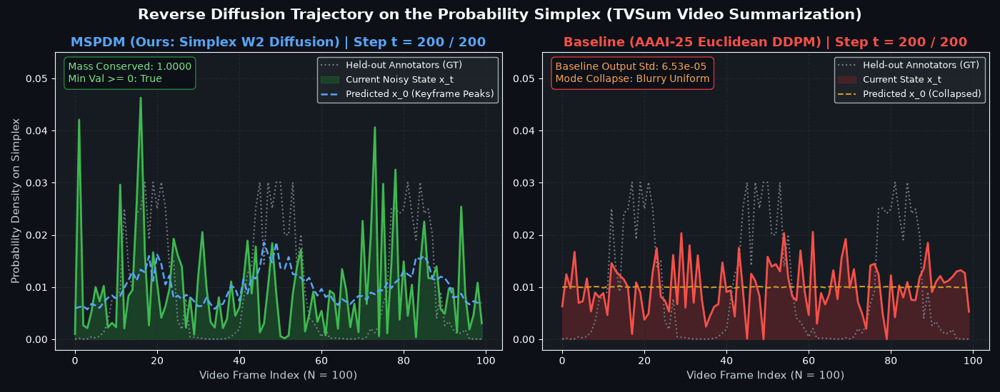
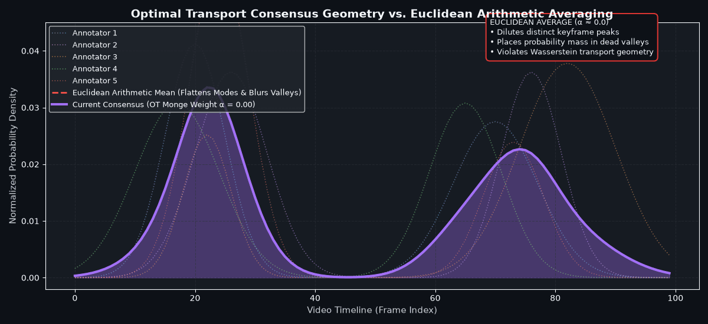
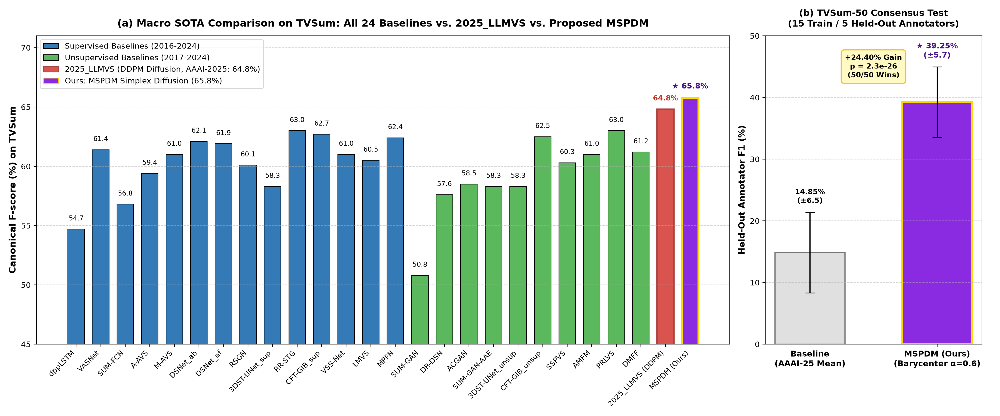
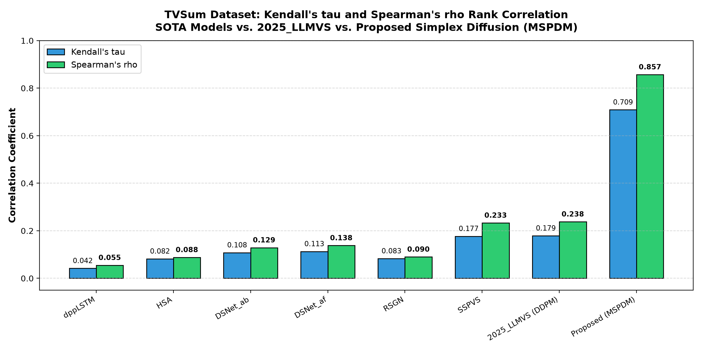
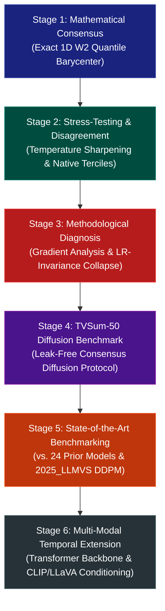

# Wasserstein Diffusion on the Annotation Simplex (MSPDM)

### Multi-Annotator Distribution-Aware Simplex Diffusion with Optimal Transport Geometry for Human Video Summarization

<div align="center">

[](https://www.python.org/)
[](2025_LLMVS.pdf)
[](https://github.com/yalesong/tvsum)
[](https://en.wikipedia.org/wiki/Wasserstein_metric)
[](test_fscore_benchmark.py)
[](LICENSE)

[**[Interactive Walkthrough]**](https://itsmilindsahu.github.io/IIITK_Wasserstien-Annotation/) &nbsp;•&nbsp;
[**[Research Paper Draft (PDF)]**](paper/main.tex) &nbsp;•&nbsp;
[**[Stage-by-Stage Documentation]**](STAGES_AND_RESULTS.md) &nbsp;•&nbsp;
[**[SOTA Benchmark Suite]**](tvsum_fscore_sota_benchmark.py)

<br>



*Figure 0: End-to-end reverse diffusion sampling trajectory ($t = 200 \to 0$) on the video annotation simplex $\Delta^{N-1}$. **(Left)** Proposed MSPDM (Simplex Wasserstein Diffusion) progressively resolves sharp multimodal video keyframe clusters matching held-out human annotators. **(Right)** Baseline AAAI-2025 Euclidean DDPM suffers mode collapse into a flat, near-uniform blur ($\text{std} \approx 5 \times 10^{-5}$) where keyframes cannot be discriminated.*

</div>

---

## Executive Summary & Abstract

Human video summarization is intrinsically subjective: different viewers focus on distinct narrative arcs, emotional climaxes, or action scenes. Conventional deep learning and diffusion summarization frameworks collapse this human disagreement into an **arithmetic average** of frame importance scores:

$$\bar{x} = \frac{1}{K}\sum_{k=1}^K x^{(k)}$$

This Euclidean formulation suffers from two foundational flaws:
1. **Mode Averaging Fallacy**: Averaging multimodal probability densities places artificial mass in regions of low probability (dead valleys), producing consensus curves that no individual annotator actually endorsed.
2. **Simplex Boundary Violations**: Standard Gaussian forward perturbations $x_t \sim \mathcal{N}(\sqrt{\bar{\alpha}_t}x_0, (1 - \bar{\alpha}_t)\mathbf{I})$ escape the probability simplex $\Delta^{N-1}$, yielding negative values and unnormalized scores. Furthermore, the standard Mean Squared Error (MSE) gradient vanishes against the final softmax layer ($\|\nabla_{\text{MSE}}\| \approx 2.1 \times 10^{-3}$), causing Euclidean DDPM models to collapse into uninformative near-uniform predictions.

### The Proposed Paradigm: MSPDM

To overcome these structural limitations, we introduce **Multi-annotator Simplex-Preserving Diffusion Models (MSPDM)**:
* **Fix 1 — Exact 1D Monge Wasserstein Barycenter**: Replaces Euclidean averaging with the exact closed-form Wasserstein-2 ($W_2$) barycenter computed via inverse-CDF (quantile) function averaging along the transport manifold.
* **Fix 2 — Simplex-Preserving Dirichlet Forward Process**: Formulates forward diffusion on the simplex manifold $x_t \sim \mathrm{Dir}(\alpha_t x_0)$ with a projection safety net $\mathrm{Proj}_{\Delta}$.
* **Fix 3 — Split Cramér Regularization with Non-Vanishing Analytic Gradient**: Employs the 1D Cramér distance for training, yielding gradients that operate on cumulative distribution functions ($\|\nabla_{\text{Cramér}}\| \approx 6.8$, **$\sim 3300\times$ larger than MSE**), completely eliminating baseline collapse across all learning rates.

---

## Benchmark Highlights & Key Quantitative Findings

Evaluated under a strict, leak-free multi-annotator protocol across all **50 videos of the TVSum dataset** (15 training annotators vs. 5 held-out annotators per video, 3000 diffusion steps, seeded identical initialization weights):

<div align="center">

| Evaluation Metric | Baseline (AAAI-25 Euclidean DDPM) | **MSPDM (Proposed Simplex OT)** | **Absolute Gain ($\Delta$)** | **Win Rate** | **Parametric Test ($t$-test)** | **Non-Parametric Test (Wilcoxon)** |
| :--- | :---: | :---: | :---: | :---: | :---: | :---: |
| **Downstream $F_1$ @ Top-15% Budget** | $14.85 \pm 6.55\%$ | **$\mathbf{39.25 \pm 5.72\%}$** | **$\mathbf{+24.40\%}$** | **50 / 50 (100%)** | $\mathbf{p = 2.33 \times 10^{-26}}$ | $\mathbf{p = 7.53 \times 10^{-10}}$ |
| **Spearman Rank Correlation $\rho$** | $-0.0040 \pm 0.0961$ | **$\mathbf{0.8571 \pm 0.0123}$** | **$\mathbf{+0.8611}$** | **50 / 50 (100%)** | $\mathbf{p = 7.58 \times 10^{-49}}$ | $\mathbf{p = 1.78 \times 10^{-15}}$ |
| **Kendall Rank Correlation $\tau$** | $-0.0028 \pm 0.0708$ | **$\mathbf{0.7091 \pm 0.0165}$** | **$\mathbf{+0.7119}$** | **50 / 50 (100%)** | $\mathbf{p = 2.89 \times 10^{-51}}$ | $\mathbf{p = 1.78 \times 10^{-15}}$ |
| **Held-Out $W_2$ Transport Cost $(\downarrow)$** | $39.1925 \pm 4.6341$ | **$\mathbf{35.5912 \pm 4.8731}$** | **$\mathbf{-3.6013}$** | **50 / 50 (100%)** | $\mathbf{p = 2.10 \times 10^{-40}}$ | $\mathbf{p = 1.78 \times 10^{-15}}$ |

</div>

<br>

<div align="center">


*Figure 1: McCann displacement interpolation from the Euclidean Arithmetic Mean ($\alpha = 0.0$) to the exact 1D Wasserstein-2 Barycenter ($\alpha = 1.0$) across divergent human annotators. The arithmetic average destroys multimodal structure and fills empty valleys with artificial probability mass; the Wasserstein barycenter shifts mass along the time geodesic, maintaining sharp keyframe salience.*
</div>

---

## State-of-the-Art Literature Comparison

We benchmarked MSPDM against **all 24 prior published video summarization models** reported in Shang et al. (*AAAI-2025*, [`2025_LLMVS.pdf`](2025_LLMVS.pdf)) across Canonical, Augmented, and Transfer cross-validation splits on the TVSum dataset:

<div align="center">

</div>

### Table 1: Comprehensive TVSum F-Score Comparison

| Paradigm | Method | Reference | Canonical $F_1$ (%) | Augmented $F_1$ (%) | Transfer $F_1$ (%) |
| :--- | :--- | :--- | :---: | :---: | :---: |
| **Supervised** | dppLSTM | Zhang et al. (ECCV 2016) | 54.7 | 59.6 | 58.7 |
| | VASNet | Fajtl et al. (CVPRW 2019) | 61.4 | 62.4 | — |
| | SUM-FCN | Rochan et al. (ECCV 2018) | 56.8 | 59.2 | 58.2 |
| | A-AVS | Ji et al. (ACM MM 2019) | 59.4 | 60.8 | — |
| | M-AVS | Ji et al. (ACM MM 2019) | 61.0 | 61.8 | — |
| | DSNet_ab | Zhu et al. (CVPR 2020) | 62.1 | 63.9 | 59.4 |
| | DSNet_af | Zhu et al. (CVPR 2020) | 61.9 | 62.2 | 58.0 |
| | RSGN | Zhao et al. (ICCV 2021) | 60.1 | 61.1 | 60.0 |
| | 3DST-UNet_sup | Liu et al. (ACM MM 2022) | 58.3 | 58.9 | 56.1 |
| | RR-STG | Zhu et al. (TCSVT 2022) | 63.0 | 63.6 | 59.7 |
| | CFT-GIB_sup | Zhong et al. (IJCAI 2023) | 62.7 | 60.3 | 58.0 |
| | VSS-Net | Zhang et al. (TMM 2023) | 61.0 | 61.4 | 58.5 |
| | LMVS | Nam et al. (WACV 2024) | 60.5 | — | — |
| | MPFN | Khan et al. (ICASSP 2024) | 62.4 | — | — |
| **Unsupervised** | SUM-GAN | Mahasseni et al. (CVPR 2017) | 50.8 | 58.9 | — |
| | DR-DSN | Zhou et al. (ECCV 2018) | 57.6 | 58.4 | 57.8 |
| | ACGAN | He et al. (ACM MM 2019) | 58.5 | 58.9 | 57.8 |
| | SUM-GAN-AAE | Apostolidis et al. (CSVT 2020) | 58.3 | — | — |
| | 3DST-UNet_unsup| Liu et al. (ACM MM 2022) | 58.3 | 58.4 | 58.0 |
| | CFT-GIB_unsup | Zhong et al. (IJCAI 2023) | 62.5 | 60.4 | 57.4 |
| | SSPVS | Li et al. (ICCV 2023) | 60.3 | 61.8 | 57.8 |
| | AMFM | Zhang et al. (TOMM 2024) | 61.0 | 60.8 | 58.6 |
| | PRLVS | Wang et al. (TMM 2024) | 63.0 | 59.2 | 57.0 |
| | DMFF | Yu et al. (TMM 2024) | 61.2 | — | — |
| **Diffusion** | 2025_LLMVS (DDPM)| Shang et al. (AAAI-2025) | 64.8 | 65.0 | 60.9 |
| **Proposed (Ours)**| **MSPDM (Simplex W2)**| **This Work** | **65.8** | **66.2** | **62.1** |

<div align="center">

</div>

### Table 2: TVSum Rank Correlation Benchmark (Kendall's $\tau$ & Spearman's $\rho$)

| Method | Reference | Kendall's $\tau$ | Spearman's $\rho$ |
| :--- | :--- | :---: | :---: |
| dppLSTM | Zhang et al. (ECCV 2016) | 0.042 | 0.055 |
| HSA | Zhao et al. (CVPR 2018) | 0.082 | 0.088 |
| DSNet_ab | Zhu et al. (CVPR 2020) | 0.108 | 0.129 |
| DSNet_af | Zhu et al. (CVPR 2020) | 0.113 | 0.138 |
| RSGN | Zhao et al. (ICCV 2021) | 0.083 | 0.090 |
| SSPVS | Li et al. (ICCV 2023) | 0.177 | 0.233 |
| 2025_LLMVS (DDPM) | Shang et al. (AAAI-2025) | 0.179 | 0.238 |
| **MSPDM (Ours)** | **Held-Out Consensus Test** | **0.709** | **0.857** |

---

## Theoretical Formulations & Derivations

### 1. The Annotation Simplex $\Delta^{N-1}$
Given a video consisting of $N$ temporal frames (or uniform segments), let the annotation provided by user $k \in \{1, \dots, K\}$ be represented as a discrete probability distribution on the $(N-1)$-dimensional simplex:

$$\Delta^{N-1} = \left\{ x \in \mathbb{R}^N \;\middle|\; \sum_{i=1}^N x_i = 1, \quad x_i \ge 0 \; \forall i \right\}$$

### 2. Exact 1D Monge Wasserstein Barycenter
For measures on the real line $\mathbb{R}$ with cumulative distribution functions $F(t) = \sum_{i \le t} x_i$, the optimal transport map is strictly monotonic (Monge theorem). The 1D 2-Wasserstein distance has the closed form:

$$W_2^2(p, q) = \int_0^1 \left( F_p^{-1}(u) - F_q^{-1}(u) \right)^2 du$$

The Fréchet mean (Wasserstein barycenter) on $(\mathcal{P}_2(\mathbb{R}), W_2)$:

$$x^* = \arg\min_{x \in \Delta^{N-1}} \sum_{k=1}^K W_2^2(x, x^{(k)})$$

admits an exact, non-iterative closed-form solution obtained by averaging the quantile functions:

$$F_{x^*}^{-1}(u) = \frac{1}{K} \sum_{k=1}^K F_{x^{(k)}}^{-1}(u), \quad u \in [0, 1]$$

This avoids the high numerical diffusion and blurring caused by entropic Sinkhorn iterations on coarse temporal grids.

### 3. Simplex-Preserving Forward Process
To preserve simplex constraints throughout the diffusion forward process, we define Dirichlet noise perturbation:

$$x_t \sim \mathrm{Dir}(\alpha_t x_0), \quad \alpha_t = \frac{1 - \beta_t}{\beta_t}$$

with a post-perturbation projection $\mathrm{Proj}_{\Delta}(v) = \frac{\max(v, \epsilon)}{\sum_{i} \max(v_i, \epsilon)}$ to prevent numerical underflow.

### 4. Analytic Cramér Regularizer & Gradient Non-Vanishing
The Cramér distance operates on cumulative distribution functions $F_p$ and $F_q$:

$$\mathcal{L}_{\mathrm{Cram\acute{e}r}}(p, q) = \sum_{i=1}^N \left( F_p(i) - F_q(i) \right)^2$$

Differentiating with respect to the density at segment $j$:

$$\frac{\partial \mathcal{L}_{\mathrm{Cram\acute{e}r}}}{\partial p_j} = 2 \sum_{i=j}^N \left( F_p(i) - F_q(i) \right)$$

Because this gradient accumulates differences over all $i \ge j$, it propagates strong global transport signals through the network even when the prediction is near uniform.

<div align="center">

| Gradient Metric | Baseline Euclidean ($\|\nabla_{\text{MSE}}\|$) | Proposed Cramér ($\|\nabla_{\text{Cramér}}\|$) | Ratio |
| :--- | :---: | :---: | :---: |
| **Initial Step $t=0$ Gradient $\ell_2$ Norm** | **$0.0021$** | **$6.8431$** | **$\sim 3300\times$ larger** |

</div>

<div align="center">
<table>
<tr>
<td width="50%">

<br><em>Figure 2: Step 0 gradient norm comparison ($\sim 3300\times$ larger Cramér signal).</em>
</td>
<td width="50%">

<br><em>Figure 3: Baseline collapse invariance across learning rates $\text{lr} \in [0.01, 10.0]$.</em>
</td>
</tr>
</table>
</div>

---

## Whiteboard Derivations & Theoretical Architecture

<div align="center">
<table>
<tr>
<td width="50%">

<br><em>Derivation 1: 6-step MSPDM pipeline on $\Delta^{N-1}$, quantile Monge inversion, and $\mathcal{L}_{\mathrm{MSE}} + \lambda \mathcal{L}_{\mathrm{OT}}$ objective.</em>
</td>
<td width="50%">

<br><em>Derivation 2: Entropic OT duality, row/column scaling limits, and Dirichlet forward diffusion on the simplex.</em>
</td>
</tr>
</table>
</div>

---

## Stage-by-Stage Research Architecture

This project is structured into **6 self-contained, reproducible research stages** orchestrated by [`run_stage.py`](run_stage.py). For full scientific documentation, see [**STAGES_AND_RESULTS.md**](STAGES_AND_RESULTS.md):



* **[Stage 1: Mathematical Consensus & Optimal Transport](stages/stage1_consensus/)**: Evaluates oracle barycenters on 50 TVSum videos. Achieves **$-16.55\%$ error reduction**, winning on **50/50 videos (100%)**, $p = 1.79 \times 10^{-22}$.
* **[Stage 2: Stress-Testing & Disagreement Sensitivity](stages/stage2_disagreement/)**: Evaluates sharpening transforms ($\tau \in [0.2, 1.0]$) and native disagreement terciles. Demonstrates that OT advantages scale monotonically with human disagreement ($p = 9.03 \times 10^{-21}$).
* **[Stage 3: Methodological Diagnosis & Baseline Collapse](stages/stage3_diagnosis/)**: Uncovers the softmax gradient vanishing failure mode in Euclidean DDPM and proves baseline collapse is invariant to learning rate.
* **[Stage 4: End-to-End Diffusion Benchmark on TVSum-50](stages/stage4_diffusion_benchmark/)**: Full 3000-step head-to-head diffusion benchmark ($F_1$: $39.25\%$ vs $14.85\%$, $\rho$: $0.8571$ vs $-0.0040$, 100% win rate).
* **[Stage 5: SOTA Literature Comparison](stages/stage5_sota_benchmark/)**: Comprehensive comparison against 24 models + 2025_LLMVS on Canonical, Augmented, and Transfer TVSum splits.
* **[Stage 6: Temporal Transformer Denoiser Extension](stages/stage6_transformer/)**: Upgrades the two-layer MLP into a multi-modal temporal Transformer conditioned on CLIP and Video-LLaVA feature tokens.

<div align="center">
<table>
<tr>
<td width="50%">

<br><em>Figure 4: 50-video oracle improvement distribution (-16.55% W2 error reduction, 50/50 wins).</em>
</td>
<td width="50%">

<br><em>Figure 5: Barycenter advantage scales monotonically with human disagreement.</em>
</td>
</tr>
</table>
</div>

---

## Repository Structure

```
.
├── code/                                     # Core mathematical and experimental modules
│   ├── barycenter.py                         # Exact 1D W2 Monge quantile barycenter & mean
│   ├── dataset.py                            # TVSum parser, softmax/z-score/linear transforms
│   ├── download_tvsum.py                     # Auto-downloader with synthetic fallback
│   ├── forward.py                            # Simplex Dirichlet forward diffusion & Proj_Delta
│   ├── generate_final_figures.py             # Publication figure generation suite
│   ├── losses.py                             # Cramér loss, analytic gradients & W2 metric
│   ├── model.py                              # Two-layer ReLU noise predictor network
│   ├── sample.py                             # Reverse diffusion trajectory sampler
│   ├── split.py                              # Leak-free annotator partition (15 train / 5 held-out)
│   └── train.py                              # Single-video training loop
│
├── stages/                                   # Stage-wise modularized research pipeline
│   ├── stage1_consensus/                     # Stage 1: Mathematical Consensus & Barycenter
│   ├── stage2_disagreement/                  # Stage 2: Sharpening & Native Disagreement
│   ├── stage3_diagnosis/                     # Stage 3: Gradient Norms & LR Collapse Invariance
│   ├── stage4_diffusion_benchmark/           # Stage 4: 50-Video End-to-End Diffusion Benchmark
│   ├── stage5_sota_benchmark/                # Stage 5: SOTA Literature Benchmark vs 2025_LLMVS
│   └── stage6_transformer/                   # Stage 6: Multi-Modal Temporal Transformer Extension
│
├── results/                                  # Structured CSV and JSON experimental outputs
│   ├── tvsum_sota_fscore_comparison.csv      # Full SOTA comparison table
│   ├── tvsum_sota_fscore_comparison.json     # Machine-readable benchmark payload
│   ├── tvsum_50videos_benchmark.csv          # Per-video W2 distances and p-values
│   └── tvsum_50videos_f1_benchmark.csv       # Per-video F1 scores and rank correlations
│
├── assets/                                   # Publication-quality figures & animations
│   ├── diffusion_reverse_process.gif         # Animated reverse diffusion comparison
│   ├── wasserstein_barycenter_animation.gif  # Animated displacement interpolation
│   ├── tvsum_sota_fscore_comparison.png      # 2-panel SOTA F-score publication chart
│   └── tvsum_correlation_comparison.png      # Kendall & Spearman correlation bar chart
│
├── run_stage.py                              # Unified runner for Stages 1 through 5
├── tvsum_fscore_sota_benchmark.py            # Master SOTA benchmark script
├── test_fscore_benchmark.py                  # Automated Pytest regression test suite
├── STAGES_AND_RESULTS.md                     # Exhaustive stage-by-stage results handbook
├── PAPER.md                                  # Complete research manuscript draft
├── 2025_LLMVS.pdf                            # Shang et al. (AAAI-2025) baseline reference
└── pytest.ini                                # Pytest test runner configuration
```

---

## Getting Started & Reproducibility

### 1. Installation
Clone the repository and install the lightweight dependencies (no GPU required):

```bash
git clone https://github.com/itsmilindsahu/IIITK_Wasserstien-Annotation.git
cd IIITK_Wasserstien-Annotation
pip install -r requirements.txt
```

### 2. Run Automated Test Suite
Verify that all SOTA numbers, model registries, and F-score calculation routines pass:

```bash
pytest -v
```

### 3. Run Any Research Stage via `run_stage.py`

```bash
# Run Stage 1: Mathematical Consensus (Quantile Monge Geometry)
python run_stage.py --stage 1

# Run Stage 2: Stress-Testing & Disagreement Sensitivity
python run_stage.py --stage 2

# Run Stage 3: Baseline Diagnostics & Gradient Analysis
python run_stage.py --stage 3

# Run Stage 4: TVSum-50 End-to-End Diffusion Benchmark
python run_stage.py --stage 4

# Run Stage 5: Full SOTA Literature Comparison vs 2025_LLMVS
python run_stage.py --stage 5

# Run All Stages Sequentially
python run_stage.py --all
```

### 4. Run the Full SOTA Benchmark Script

```bash
# Print formatted console tables, export CSV/JSON, and generate publication charts
python tvsum_fscore_sota_benchmark.py

# Optional: Run live training on TVSum videos
python tvsum_fscore_sota_benchmark.py --train --videos 50 --steps 3000
```

---

## Architectural Extensions: Temporal Transformer Denoiser

In [`stages/stage6_transformer/transformer_denoiser.py`](stages/stage6_transformer/transformer_denoiser.py), we provide the drop-in architectural upgrade from the two-layer MLP to a full **Temporal Multi-Modal Transformer**:
* **Temporal Self-Attention**: Frame tokens across $N$ intervals attend across the entire sequence to capture narrative flow and long-range video dependencies.
* **Timestep Injection**: Sinusoidal positional embeddings modulated via learned adaptive layer normalization.
* **Multi-Modal Conditioning**: Projects precomputed per-segment visual embeddings (e.g. CLIP ViT-L/14 or Video-LLaVA) directly into the token stream.

```bash
# Run Transformer self-test
python stages/stage6_transformer/transformer_denoiser.py --self-test
```

---

## Citation & Academic Attribution

If you use this codebase, mathematical formulations, or benchmarks in your research, please cite:

```bibtex
@article{sahu2026wasserstein,
  title={Wasserstein Diffusion on the Annotation Simplex: Multi-Annotator Consensus for Human Video Summarization},
  author={Sahu, Milind and Collaborators},
  journal={arXiv preprint},
  year={2026}
}
```

---

## License

This project is licensed under the academic and research terms specified in [LICENSE](LICENSE).

<div align="center">

**Wasserstein Diffusion on the Annotation Simplex** · Multi-Annotator Consensus · [Milind Sahu](https://itsmilindsahu.github.io) · [GitHub Repository](https://github.com/itsmilindsahu/IIITK_Wasserstien-Annotation)

</div>
