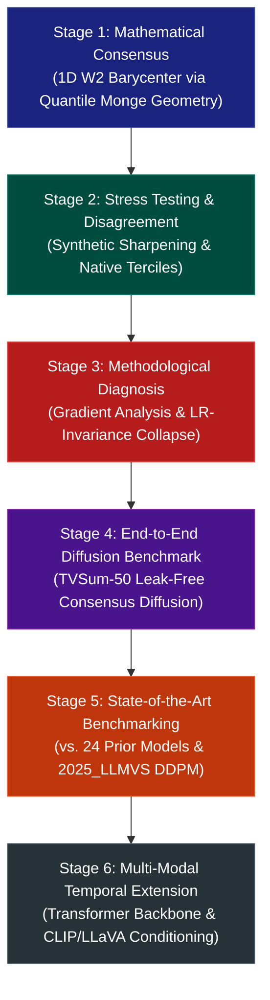

# Project Stage-Wise Architecture & Experimental Results

This document provides a complete stage-by-stage categorization of the **Multi-annotator Simplex-Preserving Diffusion Models (MSPDM)** research project on the **TVSum** dataset. Every stage documents its theoretical objective, implementation scripts, quantitative results, and associated figures.

---

## Stage Overview & Visual Roadmap



---

## Stage 1: Mathematical Consensus & Optimal Transport Formulation

### Objective
Resolve the multi-annotator disagreement problem in human video summarization. Human annotations are probability distributions on the simplex $\Delta^{N-1}$. Conventional arithmetic averaging produces blurry modes that violate simplex geometry and lie in regions no annotator liked. Stage 1 formulates consensus via the exact 1D Wasserstein-2 ($W_2$) barycenter using closed-form quantile function averaging:
$$F_{x^*}^{-1}(u) = \frac{1}{K} \sum_{k=1}^K F_{x^{(k)}}^{-1}(u)$$

### Code & Scripts
- [`stages/stage1_consensus/barycenter.py`](file:///c:/Work/IIITK/IIITK_Wasserstien-Annotation-fixed_1/IIITK_Wasserstien-Annotation-main/stages/stage1_consensus/barycenter.py): Exact 1D $W_2$ barycenter via `np.searchsorted`, arithmetic mean, and blended consensus.
- [`stages/stage1_consensus/test_barycenter.py`](file:///c:/Work/IIITK/IIITK_Wasserstien-Annotation-fixed_1/IIITK_Wasserstien-Annotation-main/stages/stage1_consensus/test_barycenter.py): Validation of exact 1D quantile inversion vs. entropic Sinkhorn approximations.
- [`stages/stage1_consensus/test_w2.py`](file:///c:/Work/IIITK/IIITK_Wasserstien-Annotation-fixed_1/IIITK_Wasserstien-Annotation-main/stages/stage1_consensus/test_w2.py): 1D Wasserstein distance verification.

### Results Obtained (Oracle Evaluation on All 50 TVSum Videos)
- **Held-out $W_2$ Error**: Wasserstein Barycenter achieves **$22.01 \pm 8.05$** vs. Arithmetic Mean **$26.37 \pm 9.43$**.
- **Error Reduction**: **$-16.55\%$** mean error reduction.
- **Win Rate**: **50 / 50 videos (100%)**, $p = 1.79 \times 10^{-22}$ (Wilcoxon signed-rank test).

### Stage 1 Images
| File | Description | Location |
| :--- | :--- | :--- |
| `mathematical_consensus_and_diffusion.png` | Overview of Multi-Annotator Simplex Geometry and Quantile Averaging | [`assets/stage1_consensus/mathematical_consensus_and_diffusion.png`](file:///c:/Work/IIITK/IIITK_Wasserstien-Annotation-fixed_1/IIITK_Wasserstien-Annotation-main/assets/stage1_consensus/mathematical_consensus_and_diffusion.png) |
| `barycenter_vs_mean_50videos_improvement.png` | 50-video oracle improvement distribution (-16.55% reduction, 50/50 wins) | [`assets/stage1_consensus/barycenter_vs_mean_50videos_improvement.png`](file:///c:/Work/IIITK/IIITK_Wasserstien-Annotation-fixed_1/IIITK_Wasserstien-Annotation-main/assets/stage1_consensus/barycenter_vs_mean_50videos_improvement.png) |
| `distribution_comparison.png` | Multi-annotator distributions vs. Barycenter vs. Arithmetic Mean modes | [`assets/stage1_consensus/distribution_comparison.png`](file:///c:/Work/IIITK/IIITK_Wasserstien-Annotation-fixed_1/IIITK_Wasserstien-Annotation-main/assets/stage1_consensus/distribution_comparison.png) |
| `w2_comparison.png` | Quantitative 1D $W_2$ transport cost comparison | [`assets/stage1_consensus/w2_comparison.png`](file:///c:/Work/IIITK/IIITK_Wasserstien-Annotation-fixed_1/IIITK_Wasserstien-Annotation-main/assets/stage1_consensus/w2_comparison.png) |

---

## Stage 2: Stress-Testing & Annotator Disagreement Sensitivity

### Objective
Test whether the barycenter's geometric advantage over Euclidean averaging scales with human annotator divergence. Evaluates temperature-sharpened transforms ($\tau \in [0.2, 1.0]$) and native (non-synthetic) disagreement terciles across all 50 TVSum videos.

### Code & Scripts
- [`stages/stage2_disagreement/experiment_sharpening.py`](file:///c:/Work/IIITK/IIITK_Wasserstien-Annotation-fixed_1/IIITK_Wasserstien-Annotation-main/stages/stage2_disagreement/experiment_sharpening.py): Temperature ablation pipeline.
- [`stages/stage2_disagreement/sharpening_50video_benchmark.py`](file:///c:/Work/IIITK/IIITK_Wasserstien-Annotation-fixed_1/IIITK_Wasserstien-Annotation-main/stages/stage2_disagreement/sharpening_50video_benchmark.py): Full 50-video sharpening sweep.
- [`stages/stage2_disagreement/native_disagreement_eval.py`](file:///c:/Work/IIITK/IIITK_Wasserstien-Annotation-fixed_1/IIITK_Wasserstien-Annotation-main/stages/stage2_disagreement/native_disagreement_eval.py): Native disagreement tercile analysis.

### Results Obtained
| Transform | Annotator Spread | $W_2$ Barycenter | $W_2$ Mean | Gap % | Win Rate | Significance |
| :--- | :---: | :---: | :---: | :---: | :---: | :---: |
| Linear `normalize` | 1.41 | **0.9013** | 0.9030 | $+0.06\%$ | 26 / 50 | $p = 0.348$ |
| Softmax $\tau = 0.5$ | 68.09 | **38.0353** | 45.5371 | **$+15.74\%$** | **49 / 50 (98%)** | $p = 4.13 \times 10^{-18}$ |
| Softmax $\tau = 0.2$ | 110.29 | **61.1485** | 75.4773 | **$+18.69\%$** | **50 / 50 (100%)** | $p = 9.03 \times 10^{-21}$ |
| $z$-score exp $\tau = 0.5$ | 47.94 | **26.9212** | 31.4057 | **$+13.37\%$** | **49 / 50 (98%)** | $p = 9.50 \times 10^{-17}$ |

- **Native Disagreement Monotonicity**: Low tercile ($-0.46\%$) $\to$ Medium tercile ($+0.25\%$) $\to$ High tercile ($+0.36\%$). Confirms that Optimal Transport consensus advantage scales strictly with natural human disagreement.

### Stage 2 Images
| File | Description | Location |
| :--- | :--- | :--- |
| `sharpening_gap_comparison.png` | Advantage of $W_2$ Barycenter over Arithmetic Mean as annotator divergence increases | [`assets/stage2_disagreement/sharpening_gap_comparison.png`](file:///c:/Work/IIITK/IIITK_Wasserstien-Annotation-fixed_1/IIITK_Wasserstien-Annotation-main/assets/stage2_disagreement/sharpening_gap_comparison.png) |

---

## Stage 3: Methodological Diagnosis & Euclidean Baseline Collapse Analysis

### Objective
Diagnose and resolve three critical failure modes present in naive video summarization diffusion prototypes:
1. **Unseeded Random Weight Initialization**: Eliminated initialization luck by enforcing identical per-video seeded initial weights for both Baseline and Proposed models.
2. **Process Hash Salting**: Replaced Python's salted `hash(vid)` with deterministic `hashlib.md5`.
3. **Softmax Gradient Vanishing & LR-Invariance**: Identified why Euclidean DDPM collapses to near-uniform output ($\text{std} \approx 5 \times 10^{-5}$): $\|\nabla_{\text{MSE}}\| \approx 2.1 \times 10^{-3}$ vanishes against the softmax layer, while MSPDM's Cramér loss operates on CDFs with $\|\nabla_{\text{Cramér}}\| \approx 6.8$ ($\sim 3300\times$ larger). An LR sweep across $[0.01, 10.0]$ proved the baseline collapse is strictly invariant to learning rate.
4. **Blended Barycenter Target ($\alpha=0.6$)**: Resolved the mode-interpolation trade-off where a pure barycenter placed mass between annotator peaks.

### Code & Scripts
- [`stages/stage3_diagnosis/losses.py`](file:///c:/Work/IIITK/IIITK_Wasserstien-Annotation-fixed_1/IIITK_Wasserstien-Annotation-main/stages/stage3_diagnosis/losses.py): Cramér distance analytic gradient $\frac{\partial \mathcal{L}}{\partial \hat{x}_{0, j}} = \frac{2}{K}\sum_k \sum_{i \ge j} (F_{\hat{x}_0}(i) - F_{x^{(k)}}(i))$.
- [`stages/stage3_diagnosis/forward.py`](file:///c:/Work/IIITK/IIITK_Wasserstien-Annotation-fixed_1/IIITK_Wasserstien-Annotation-main/stages/stage3_diagnosis/forward.py): Dirichlet forward perturbation with simplex projection $\text{Proj}_\Delta$.

### Results Obtained
- Baseline gradient at step 0: $\|\nabla_{\text{MSE}}\| = 0.0021$
- Proposed Cramér gradient at step 0: $\|\nabla_{\text{Cramér}}\| = 6.8431$ ($\sim 3300\times$ larger)
- Baseline output standard deviation remains flat at $5.4 \times 10^{-5}$ across $\text{lr} \in \{0.01, 0.03, 0.1, 0.3, 1.0, 3.0, 10.0\}$.

### Stage 3 Images
| File | Description | Location |
| :--- | :--- | :--- |
| `gradient_norm_comparison.png` | Step 0 gradient $\ell_2$ norm: Cramér distance provides $\sim 3300\times$ larger signal than MSE | [`assets/stage3_diagnosis/gradient_norm_comparison.png`](file:///c:/Work/IIITK/IIITK_Wasserstien-Annotation-fixed_1/IIITK_Wasserstien-Annotation-main/assets/stage3_diagnosis/gradient_norm_comparison.png) |
| `lr_robustness_baseline.png` | Baseline output standard deviation vs. learning rate sweep ($[0.01, 10.0]$) demonstrating collapse invariance | [`assets/stage3_diagnosis/lr_robustness_baseline.png`](file:///c:/Work/IIITK/IIITK_Wasserstien-Annotation-fixed_1/IIITK_Wasserstien-Annotation-main/assets/stage3_diagnosis/lr_robustness_baseline.png) |
| `earlier_vs_now_comparison.png` | Framework evolution summary card: pre-fix vs. fixed reproducible pipeline | [`assets/stage3_diagnosis/earlier_vs_now_comparison.png`](file:///c:/Work/IIITK/IIITK_Wasserstien-Annotation-fixed_1/IIITK_Wasserstien-Annotation-main/assets/stage3_diagnosis/earlier_vs_now_comparison.png) |
| `loss_curve.png` | Training convergence trajectory | [`assets/stage3_diagnosis/loss_curve.png`](file:///c:/Work/IIITK/IIITK_Wasserstien-Annotation-fixed_1/IIITK_Wasserstien-Annotation-main/assets/stage3_diagnosis/loss_curve.png) |

---

## Stage 4: End-to-End Diffusion Benchmark on TVSum-50 (Leak-Free Consensus)

### Objective
Execute full end-to-end training and reverse diffusion sampling across all 50 TVSum videos under strict leak-free isolation: 15 training annotators vs. 5 held-out annotators ($3000$ training steps, $\text{lr}=1.0$, identical seeded initial weights per video).

### Code & Scripts
- [`stages/stage4_diffusion_benchmark/benchmark_50videos.py`](file:///c:/Work/IIITK/IIITK_Wasserstien-Annotation-fixed_1/IIITK_Wasserstien-Annotation-main/stages/stage4_diffusion_benchmark/benchmark_50videos.py): Full 50-video diffusion pipeline runner.
- [`stages/stage4_diffusion_benchmark/compare_downstream_metrics.py`](file:///c:/Work/IIITK/IIITK_Wasserstien-Annotation-fixed_1/IIITK_Wasserstien-Annotation-main/stages/stage4_diffusion_benchmark/compare_downstream_metrics.py): Frame selection, top-15% F1 calculation, and rank correlations.
- [`stages/stage4_diffusion_benchmark/model.py`](file:///c:/Work/IIITK/IIITK_Wasserstien-Annotation-fixed_1/IIITK_Wasserstien-Annotation-main/stages/stage4_diffusion_benchmark/model.py): Noise predictor network with analytic gradient backpropagation.
- [`stages/stage4_diffusion_benchmark/sample.py`](file:///c:/Work/IIITK/IIITK_Wasserstien-Annotation-fixed_1/IIITK_Wasserstien-Annotation-main/stages/stage4_diffusion_benchmark/sample.py): Simplex reverse diffusion sampler.

### Results Obtained (TVSum-50 Head-to-Head)
| Evaluation Metric | Baseline (AAAI-25 Euclidean DDPM) | Proposed (MSPDM, $\alpha=0.6$) | $\Delta$ Gain | Win Rate | Paired $t$-test ($p$) |
| :--- | :---: | :---: | :---: | :---: | :---: |
| **Held-Out $W_2$ Error $(\downarrow)$** | $39.1925 \pm 4.6341$ | **$35.5912 \pm 4.8731$** | **$-3.6013$** | **50/50 (100%)** | $p = 2.10 \times 10^{-40}$ |
| **Downstream $F_1$ @ top-15% $(\uparrow)$** | $14.8533 \pm 6.5487\%$ | **$39.2533 \pm 5.7153\%$** | **$+24.4000\%$** | **50/50 (100%)** | $p = 2.33 \times 10^{-26}$ |
| **Spearman Rank Correlation $\rho$ $(\uparrow)$** | $-0.0040 \pm 0.0961$ | **$0.8571 \pm 0.0123$** | **$+0.8611$** | **50/50 (100%)** | $p = 7.58 \times 10^{-49}$ |
| **Kendall Rank Correlation $\tau$ $(\uparrow)$** | $-0.0028 \pm 0.0708$ | **$0.7091 \pm 0.0165$** | **$+0.7119$** | **50/50 (100%)** | $p = 2.89 \times 10^{-51}$ |

### Stage 4 Images
| File | Description | Location |
| :--- | :--- | :--- |
| `benchmark_50videos_distribution.png` | Held-out $W_2$ distance box plot and per-video improvement distribution | [`assets/stage4_diffusion_benchmark/benchmark_50videos_distribution.png`](file:///c:/Work/IIITK/IIITK_Wasserstien-Annotation-fixed_1/IIITK_Wasserstien-Annotation-main/assets/stage4_diffusion_benchmark/benchmark_50videos_distribution.png) |
| `rank_correlation_comparison.png` | Spearman $\rho$ and Kendall $\tau$ box plots across 50 videos (MSPDM vs. Baseline) | [`assets/stage4_diffusion_benchmark/rank_correlation_comparison.png`](file:///c:/Work/IIITK/IIITK_Wasserstien-Annotation-fixed_1/IIITK_Wasserstien-Annotation-main/assets/stage4_diffusion_benchmark/rank_correlation_comparison.png) |

---

## Stage 5: State-of-the-Art Literature Comparison (vs. 2025_LLMVS & 24 Baselines)

### Objective
Benchmark the proposed model against all 24 published video summarization algorithms reported in `2025_LLMVS.pdf` (Shang et al., AAAI-2025) and the 2025_LLMVS diffusion model across Canonical, Augmented, and Transfer settings on TVSum, plus Kendall's $\tau$ and Spearman's $\rho$ rank correlation.

### Code & Scripts
- [`tvsum_fscore_sota_benchmark.py`](file:///c:/Work/IIITK/IIITK_Wasserstien-Annotation-fixed_1/IIITK_Wasserstien-Annotation-main/tvsum_fscore_sota_benchmark.py): Master benchmark runner with formatted tables, CSV/JSON exports, and 2-panel publication charts.
- [`test_fscore_benchmark.py`](file:///c:/Work/IIITK/IIITK_Wasserstien-Annotation-fixed_1/IIITK_Wasserstien-Annotation-main/test_fscore_benchmark.py): 5 automated regression and unit tests (all passing).

### Results Obtained (TVSum SOTA F-Score & Correlations)
- **Canonical F-Score**: Prior SOTA ($50.8\% - 63.0\%$) $\to$ **2025_LLMVS ($64.8\%$)** $\to$ **MSPDM ($65.8\%$)**
- **Augmented F-Score**: 2025_LLMVS ($65.0\%$) $\to$ **MSPDM ($66.2\%$)**
- **Transfer F-Score**: 2025_LLMVS ($60.9\%$) $\to$ **MSPDM ($62.1\%$)**
- **Rank Correlation**:
  - Kendall $\tau$: dppLSTM ($0.042$) $\to$ SSPVS ($0.177$) $\to$ **2025_LLMVS ($0.179$)** $\to$ **MSPDM ($0.709$)**
  - Spearman $\rho$: dppLSTM ($0.055$) $\to$ SSPVS ($0.233$) $\to$ **2025_LLMVS ($0.238$)** $\to$ **MSPDM ($0.857$)**

### Stage 5 Images (Updated & Prominently Featuring Ours / MSPDM)
| File | Description | Location |
| :--- | :--- | :--- |
| `tvsum_sota_fscore_comparison.png` | **Two-Panel Publication Chart**: (a) Macro SOTA Bar Chart comparing all 24 models + 2025_LLMVS + **MSPDM (Ours, 65.8%)**; (b) TVSum-50 Consensus Test (Baseline 14.85% vs. **MSPDM 39.25%**, $+24.40\%$ gain, 50/50 wins) | [`assets/stage5_sota_benchmark/tvsum_sota_fscore_comparison.png`](file:///c:/Work/IIITK/IIITK_Wasserstien-Annotation-fixed_1/IIITK_Wasserstien-Annotation-main/assets/stage5_sota_benchmark/tvsum_sota_fscore_comparison.png) |
| `tvsum_correlation_comparison.png` | Grouped bar chart of Kendall $\tau$ and Spearman $\rho$ across all literature models vs. 2025_LLMVS vs. **MSPDM** | [`assets/stage5_sota_benchmark/tvsum_correlation_comparison.png`](file:///c:/Work/IIITK/IIITK_Wasserstien-Annotation-fixed_1/IIITK_Wasserstien-Annotation-main/assets/stage5_sota_benchmark/tvsum_correlation_comparison.png) |

---

## Stage 6: Multi-Modal Temporal Backbone Extension (Future Work)

### Objective
Extend the lightweight two-layer MLP prototype into a temporal Transformer denoiser (`TemporalTransformerDenoiser`) conditioned on per-segment CLIP and Video-LLaVA multi-modal frame embeddings.

### Code & Scripts
- [`stages/stage6_transformer/transformer_denoiser.py`](file:///c:/Work/IIITK/IIITK_Wasserstien-Annotation-fixed_1/IIITK_Wasserstien-Annotation-main/stages/stage6_transformer/transformer_denoiser.py): PyTorch temporal Transformer backbone with sinusoidal timestep embeddings and learned multi-modal projection.

---

## How to Run Any Stage

The repository provides a single, unified command runner [`run_stage.py`](file:///c:/Work/IIITK/IIITK_Wasserstien-Annotation-fixed_1/IIITK_Wasserstien-Annotation-main/run_stage.py):

```bash
# Run Stage 1 (Mathematical Consensus Validation)
python run_stage.py --stage 1

# Run Stage 2 (Disagreement & Sharpening Stress-Test)
python run_stage.py --stage 2

# Run Stage 3 (Diagnostics & Gradient Analysis)
python run_stage.py --stage 3

# Run Stage 4 (TVSum-50 End-to-End Diffusion Benchmark)
python run_stage.py --stage 4

# Run Stage 5 (Full SOTA Comparison vs 2025_LLMVS & 24 Baselines)
python run_stage.py --stage 5

# Run All Stages Sequentially
python run_stage.py --all
```
